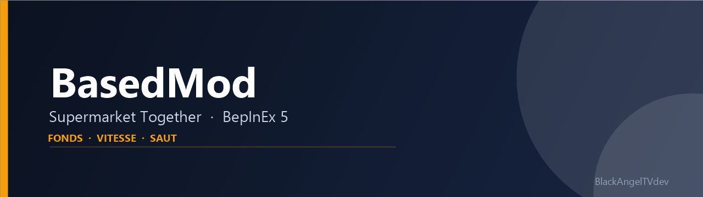

# 🚀 ItemAdder


> **ItemAdder — un mod BepInEx 5 pour Supermarket Together qui ajoute les items basiques manquants.**

---

## 🧐 Aperçu


## ✨ Fonctionnalités
- ✅ **Rayon Tabac** : ajoute 44 produits vendables dans un nouveau groupe « Tabac » du carnet de commandes — cigarettes, tabac à rouler, tubes et filtres, vapes jetables et e-liquides, snus, tabac chauffé, cigares et articles pour fumeurs.
- ✅ **Visuels variés** : chaque produit possède son icône et son prefab 3D (paquet, blague, bouteille, vape, boîte métallique, cigare, briquet, cendrier, grinder, etc.).
- ✅ **Palier d'arbre de compétences** : ajoute « Tabac I » juste après « Fruits de mer I ». Le palier coûte 1 point de franchise et exige « Fruits de mer I ».
- ✅ **Prix libres** : les produits passent par la machine à prix comme les autres articles ; leur prix de base est prérempli.
- ✅ **Multiplicateur de fonds** : modifie les montants ajoutés ou retirés via `GameData.CmdAlterFunds`, sans toucher au reste de l'économie.
- ✅ **Configuration sans recompilation** : le rayon tabac peut être désactivé dans un fichier `.cfg` généré par BepInEx.
- ✅ **Build automatique** : chaque `dotnet build` copie le DLL du mod directement dans `BepInEx\plugins`.
- ✅ **Chargement optimisé** : les prefabs, icônes et matériaux du rayon sont générés une seule fois puis réutilisés entre les parties ; les temps de chargement sont tracés dans le log (`[Perf]`).
- ✅ **Launcher Windows** : application native C# (WinForms) qui détecte le jeu, installe BepInEx si nécessaire, compare la version installée aux releases GitHub et met le mod à jour.

## 🛠 Tech Stack
| Technologie | Usage |
| :--- | :--- |
|  | Logique du mod |
|  | Chargement du plugin, logs et configuration |
|  | Patches runtime sur le code du jeu |
|  | Moteur du jeu ciblé |

## 🚀 Installation & Lancement

### Prérequis
- **Windows** et la version **Steam** de Supermarket Together.
- **.NET SDK 8** (ou plus récent) avec le **targeting pack .NET Framework 4.7.2** pour compiler.
- **BepInEx 5 x64** dans le dossier du jeu (le launcher l'installe automatiquement s'il est absent).

### Launcher (recommandé)
Le launcher est une **application Windows native** (C# WinForms), pas un script PowerShell. L'exécutable publié se trouve dans :

```text
dist\ItemAdderLauncher.exe
```

Double-clique dessus. Le launcher :

- détecte le dossier Steam de Supermarket Together (registre Steam et `libraryfolders.vdf`), ou te laisse le choisir ;
- affiche la version installée et la dernière release GitHub ;
- installe **BepInEx 5.4.23.5 x64** s'il est absent ;
- télécharge l'asset de la dernière release (`ItemAdder.dll`, `MonSupermarketMod.dll` ou archive ZIP) et l'installe dans `BepInEx\plugins\ItemAdder.dll` ;
- remplace l'ancien `MonSupermarketMod.dll` pour éviter de charger deux versions du mod ;
- permet de lancer le jeu avec le mod, de le lancer en **vanilla** (BepInEx désactivé pour cette session), d'ouvrir `BepInEx\plugins` et d'installer un DLL local pour réparer ou tester un build.

Pour générer l'exécutable depuis les sources :

```bash
dotnet publish ItemAdderLauncher/ItemAdderLauncher.csproj -c Release -r win-x64 --self-contained true -p:PublishSingleFile=true -p:IncludeNativeLibrariesForSelfExtract=true -o dist
```

L'exécutable publié est autonome : le **.NET Desktop Runtime n'est pas requis** sur le PC cible.

Pour publier une mise à jour, crée une release GitHub avec un tag `vX.Y.Z` et joins un asset `ItemAdder.dll` ou une archive ZIP contenant `ItemAdder.dll`/`MonSupermarketMod.dll`. Le launcher sélectionne automatiquement cet asset. En l'absence de release, le bouton **« Installer un DLL local... »** permet d'installer le build compilé.

### 1. Installer BepInEx manuellement
Le script fourni télécharge BepInEx **5.4.23.5 x64** et l'extrait dans le dossier du jeu. Il ne fait rien si BepInEx est déjà présent.

```powershell
powershell -ExecutionPolicy Bypass -File .\Install-BepInEx.ps1 -GamePath "E:\SteamLibrary\steamapps\common\Supermarket Together"
```

Sans `-GamePath`, le script utilise `E:\SteamLibrary\steamapps\common\Supermarket Together`. Adapte le chemin à ton installation Steam.

Installation manuelle possible : télécharge `BepInEx_win_x64_5.4.23.5.zip` depuis les releases BepInEx et extrais son contenu à la racine du jeu (à côté de `Supermarket Together.exe`).

### 2. Cloner le projet
```bash
git clone https://github.com/BlackAngelTVdev/BasedMod.git
cd BasedMod
```

### 3. Configurer le chemin du jeu
Ouvre `ItemAdder/ItemAdder.csproj` et adapte la propriété `GameDir` :

```xml
<GameDir>E:\SteamLibrary\steamapps\common\Supermarket Together\</GameDir>
```

Les DLL de référence (`BepInEx.dll`, `0Harmony.dll`, `Assembly-CSharp.dll`, `Unity.TextMeshPro.dll`, `Rewired_Core.dll`, etc.) sont lues depuis ce dossier.

### 4. Compiler et installer le plugin
```bash
cd ItemAdder
dotnet build -c Release
```

La cible post-build copie automatiquement `ItemAdder.dll` dans :

```
[GameDir]\BepInEx\plugins\ItemAdder.dll
```

Si tu préfères installer un DLL déjà compilé, copie simplement `ItemAdder.dll` dans `BepInEx\plugins\`. Le build supprime aussi l'ancien `MonSupermarketMod.dll` pour éviter de charger deux versions.

### 5. Lancer le jeu
Démarre Supermarket Together, puis vérifie `BepInEx\LogOutput.log`. Tu dois y voir :

```
ItemAdder v1.2.1 chargé.
[Tabac] Rayon ajouté : 44 produits, palier 55 ('Tabac I'), groupe 19, produits 339-382. Prérequis : palier 23 ('Fruits de mer I').
```

## 📖 Utilisation
Au premier lancement, BepInEx crée le fichier :

```
BepInEx\config\com.username.supermarkettogethermod.cfg
```

Modifie les valeurs puis relance le jeu (la configuration est lue au démarrage) :

```ini
[Tabac]
ActiverRayonTabac = true

[Général]
MultiplicateurDeFonds = 1
```

| Clé | Section | Défaut | Effet |
| :--- | :--- | :---: | :--- |
| `ActiverRayonTabac` | `Tabac` | `true` | Ajoute (ou non) le rayon tabac et son palier d'arbre de compétences |
| `MultiplicateurDeFonds` | `Général` | `1` | Multiplie les fonds ajoutés/retirés (`1` = vanilla) |

### Utiliser le rayon tabac
1. Débloque d'abord **Fruits de mer I** dans l'arbre de compétences.
2. Achète le nœud **Tabac I** (1 point de franchise), placé à côté du nœud Fruits de mer I.
3. Le groupe **Tabac** apparaît dans le carnet de commandes. Commande les produits, place-les en rayon et vends-les.
4. Les prix se règlent sur la machine à prix comme pour les autres produits.

Le catalogue couvre :

- **Cigarettes et tabac à rouler** : paquets classiques, menthol, blondes, brunes, light et roulées, blagues de tabac, tubes, filtres, filtreuse et feuilles à rouler.
- **Vapes et e-liquides** : vapes jetables, recharges, résistances et e-liquides (tabac, menthe, fruits rouges).
- **Nicotine alternative** : sachets de nicotine (snus/pouches) et tabac chauffé avec ses bâtonnets.
- **Cigares** : cigares, cigare premium, cigarillos vanille, cave à cigares et humidificateur.
- **Accessoires** : briquets, zippo, briquet tempête, cendriers, grinder, filtres, étui à cigarettes et porte-cigarette.

### Raccourci F5
En solo ou en tant qu'hôte, appuie sur **F5** pour ajouter **50 points de franchise**. En multijoueur client, le raccourci est ignoré : les points doivent être modifiés par l'hôte.

> ⚠️ Le mod ajoute des produits et un palier à la fin des tableaux du jeu. **Tous les joueurs doivent avoir le mod** (et la même version) pour que le multijoueur reste synchronisé. Désactiver `ActiverRayonTabac` après avoir utilisé le rayon tabac dans une sauvegarde peut rendre cette sauvegarde illisible : garde l'option active pour les parties concernées.

## 🗂 Structure du projet
```text
BasedMod/
├── Asset/Img/banner.png
├── Install-BepInEx.ps1
├── ItemAdderLauncher/
│   ├── ItemAdderLauncher.csproj
│   ├── app.manifest
│   ├── Program.cs
│   ├── MainForm.cs
│   ├── Diagnostics.cs
│   ├── Core/
│   │   ├── GameLocator.cs
│   │   ├── GitHubService.cs
│   │   ├── ModService.cs
│   │   ├── Models.cs
│   │   ├── VersionHelper.cs
│   │   └── LauncherSettings.cs
│   └── UI/
│       ├── Theme.cs
│       ├── RoundedPanel.cs
│       ├── RoundedButton.cs
│       └── RoundedTextBox.cs
└── ItemAdder/
    ├── Plugin.cs
    ├── Patches/
    │   ├── GameDataPatch.cs
    │   └── TobaccoPatches.cs
    ├── Tobacco/
    │   ├── TobaccoManager.cs
    │   └── TobaccoSkillNode.cs
    └── ItemAdder.csproj
```

## 🤝 Contribution
1. Forkez le projet
2. Créez votre branche (`git checkout -b feature/AmazingFeature`)
3. Commit (`git commit -m 'Add some AmazingFeature'`)
4. Push (`git push origin feature/AmazingFeature`)
5. Ouvrez une Pull Request

## 👤 Auteur

**BlackAngelTVdev**


---
## 📄 Licence

Aucune licence explicite n'est encore définie pour ce dépôt :


> Mod non officiel, non affilié aux développeurs de Supermarket Together.

### 🧑‍💻 Contributors

Merci à toutes les personnes qui contribuent au projet.

[](https://github.com/BlackAngelTVdev/BasedMod/graphs/contributors)
